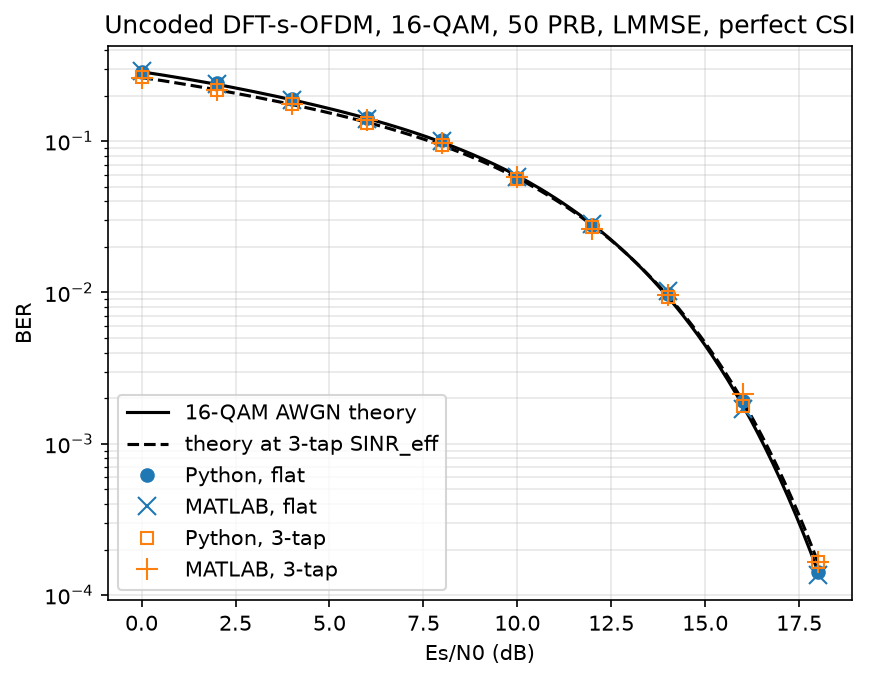

# dfts-ofdm

An uncoded DFT-s-OFDM (transform-precoded OFDM) uplink link in Python with NumPy, ported from MATLAB 5G Toolbox and checked against it. Both a single-tap and a 3-tap channel are equalized with a per-subcarrier, unbiased LMMSE equalizer using perfect channel knowledge.

## System

| Parameter | Value |
|---|---|
| Carrier | 52 RB, 15 kHz SCS, N_FFT = 1024, normal CP (80 / 72 samples) |
| Allocation | 50 PRB (M = 600 subcarriers), 12 data symbols per slot (symbols 2 and 11 left empty) |
| Modulation | 16-QAM, TS 38.211 Gray mapping, unit average energy |
| Transform precoding | M-point unitary DFT per OFDM symbol |
| Channels | flat h = [1]; fixed 3-tap h ∝ [0.8, 0.5, 0.3], unit energy, delay spread < CP |
| Noise | complex AWGN; time-domain variance 1/(N_FFT · Es/N0) gives variance 1/(Es/N0) per subcarrier |
| Receiver | CP removal, FFT, per-subcarrier LMMSE, unbiasing, IDFT despreading, hard demapping |

**Unbiased LMMSE.** W_k = H_k* / (|H_k|² + σ²). After IDFT despreading, each QAM symbol sees the average gain μ = mean_k(W_k H_k), so the output is divided by μ. The post-despreading SINR is μ / (1 − μ). For a flat channel this equals Es/N0.

## Results



- **Flat channel.** The simulated BER matches exact Gray 16-QAM AWGN theory, [3Q(d) + 2Q(3d) − Q(5d)] / 4. Ratios are 0.965–1.066 with at least 500 bit errors per point, and 1.008 at 16 dB with 5000 errors.
- **3-tap channel.** The BER matches 16-QAM theory evaluated at the LMMSE SINR μ/(1 − μ), with ratios 0.93–1.01. At low SNR it is slightly better than AWGN, because the mean |H|² over the 600 allocated subcarriers is 1.52.
- **Python vs MATLAB.** At every point the two implementations agree within Monte Carlo error. With 5000 errors at 16 dB, the Python/MATLAB ratio is 1.017 (flat) and 0.979 (3-tap). The transmitter signals (QAM, DFT output, grid, time waveform) match MATLAB to a relative error below 1e-15 on the same input bits.

## Files

| File | Content |
|---|---|
| `params.py` | carrier and allocation parameters |
| `dfts_day4.py` | transmitter, receiver front end, comparison with MATLAB, noiseless loopback |
| `ref_day4.m`, `ref_day4.mat` | MATLAB reference signals for the comparison |
| `dfts_day5.py` | AWGN, LMMSE, BER vs Es/N0 Monte Carlo (independent random streams per point) |
| `ref_day5.m` | the same simulation in MATLAB 5G Toolbox |
| `plot_overlay.py` | Python vs MATLAB overlay and ratio table |

## Run

```bash
python dfts_day4.py      # Python vs MATLAB signal check, noiseless loopback
python dfts_day5.py      # BER curves (a few seconds); saves ber_python.npz, ber_day5.png
# in MATLAB: ref_day5    # saves ber_matlab.mat
python plot_overlay.py   # saves ber_overlay.png
```

Tested with Python 3.14, NumPy 2.5, SciPy 1.18, Matplotlib 3.11, and MATLAB R2023b with 5G Toolbox.

## Next

LLR demapping, LDPC-coded BLER, a maximum-likelihood detector baseline, and a neural detector trained in PyTorch.